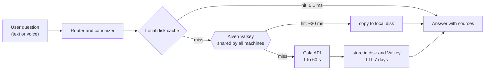
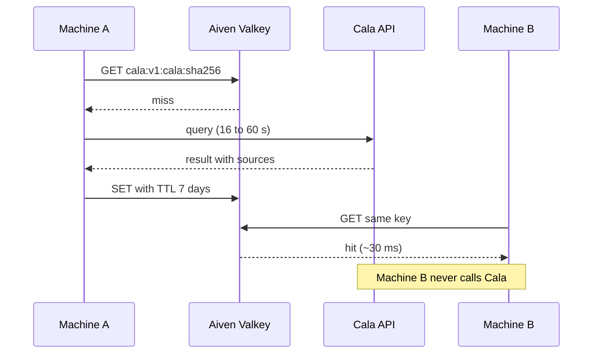
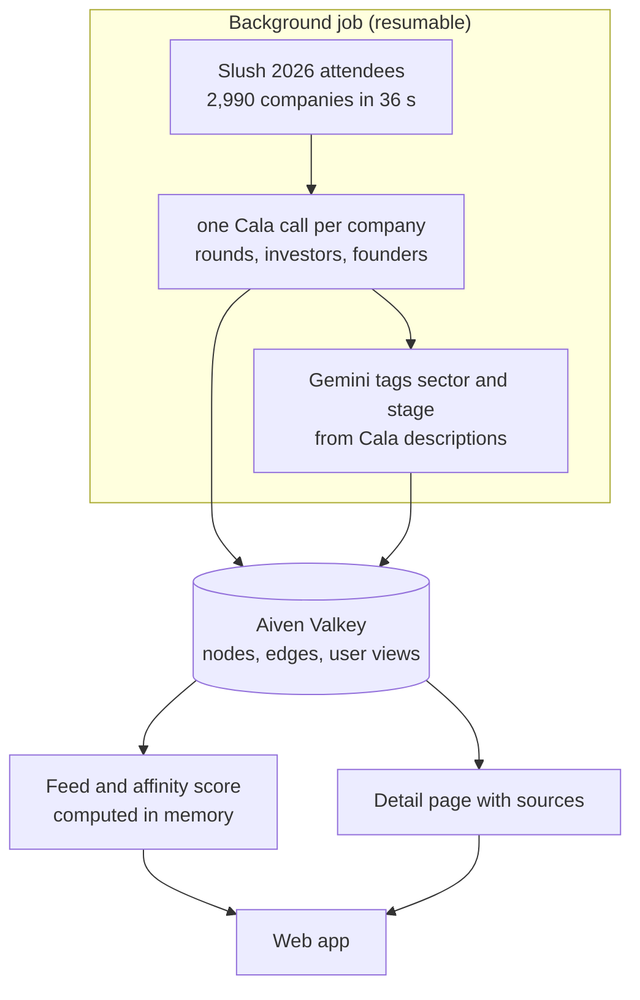

# How Cala Match uses Aiven for Valkey

**Short version:** Cala is a knowledge graph with slow, rate-limited endpoints (1 to 60 s per call, HTTP 429 after about ten calls in three seconds). We put **Aiven Valkey** in front of it as a shared memory for every machine and user. What anyone asks once is answered in ~30 ms for everyone else, with **zero calls to Cala**.

All numbers below were measured on 14 November 2026 against the real Cala API and our real Aiven service. Status tags: **In main** (running today), **In progress** (open pull request) and **Planned**.

## 1. The problem Valkey solves

| Cala endpoint | Time per call | Limit we hit |
|---|---|---|
| `knowledge/query` and `knowledge/search` | 16 to 60 s | HTTP 429 after ~7 calls in a row |
| Entity retrieval (the graph endpoints) | 0.5 to 1.7 s | HTTP 429 on the 10th call in ~3 s |

A product that waits a minute for every answer, and gets throttled by the third user, cannot be demoed. Valkey makes the second asker (a teammate, another user, the same user tomorrow) free.

## 2. Where it sits



**In main.** The cache is two layers, `LayeredCache(disk, Valkey)` in `canonizador/canonizador/cache.py`. Reads go disk first, then Valkey, and a Valkey hit is copied to disk. Writes go to both. Every Cala call in the project passes through it (`CalaClient.request`), and so do the Gemini intents the canonizer extracts.

## 3. What it saves (measured)

| Measurement | Without the cache | With Aiven Valkey |
|---|---|---|
| Same chat question asked twice through our backend | **27.7 s** (first time) | **1.45 s** (second time, includes our own router) |
| One Cala entity lookup | 0.5 to 1.7 s | **~30 ms** (5 reads: 29.1, 29.8, 30.8, 30.0, 29.4 ms) |
| Cala calls needed for a repeated question | 1 or more | **0** |
| Fresh machine (empty disk) reading something another machine already asked | a full Cala call | **~30 ms and 0 Cala calls** |

```text
one Cala entity lookup     ████████████████████████████████████████  ~1000 ms
the same from Valkey       █                                           ~30 ms
                           (about 30 times faster; 500 to 2000 times for the slow query endpoints)
```

Why it matters beyond speed:
- **It protects the rate limit.** Cala throttles around 1 to 2 entity calls per second. Every hit is a call we do not spend, which is what lets four developers and a live demo share one API key.
- **It makes the demo safe.** `python -m canonizador.cache_sync` uploads everything cached on disk to Valkey, so the answers we show on stage are pre-warmed and do not depend on Cala's speed that day.
- **It lets us measure the saving.** `canonizador.cache.STATS` counts `local_hits`, `remote_hits` and `misses` per process.

## 3b. Two machines, one memory



## 4. What is in the Valkey right now

Read from the live service (values were not printed, only counts and sizes):

| Namespace (key prefix `cala:v1:`) | Keys | Size | Expiry | What it holds |
|---|---|---|---|---|
| `cala` | 106 | 754 KB | 7 days | Raw Cala responses (entities, queries, search) |
| `intents` | 59 | 9 KB | none | What Gemini extracted from a question (intent), so the same phrasing never pays the model again |
| `llm` | 38 | 22 KB | 7 days | Cached model outputs |
| `knowledge_queries` | 12 | 19 KB | 7 days | Canonical structured queries |
| `answers` | 6 | 4 KB | 7 days | Finished canonized answers |

**Service:** Aiven for Valkey 9.1.3, TLS (`rediss://`), 2.43 GB of memory, `noeviction` policy. We use **6.6 MB (0.27%)**. Keys are `cala:v1:<namespace>:<sha256 of the canonical request>`, values are JSON.

Because the policy is `noeviction` (Valkey never silently drops data), **every key carries a TTL** except the small intent set. A full instance would reject writes instead of evicting, so we cap and expire on purpose.

## 5. Engineering details (what makes it safe to depend on)

- **Optional by design.** If `VALKEY_URL` is missing or the service is down, the cache degrades to disk only. A Valkey failure never breaks a user request.
- **Fast failure.** Connect timeout 8 s, operation timeout 3 s (`VALKEY_CONNECT_TIMEOUT`, `VALKEY_TIMEOUT`). After an error the remote is skipped for 60 s instead of retrying on every call.
- **One connection per process**, opened in the background when the backend starts (`warmup()`), so the first user does not pay the TLS handshake. Measured: the very first read on a cold connection took ~500 ms; with the connection open it takes ~30 ms.
- **Stable keys.** The canonizer turns every phrasing of a question into one canonical query, so different wordings of the same question share one cache entry. Cala itself answers differently to different phrasings, so without canonization the cache would almost never hit. See [BENCHMARK-CANONIZADOR.md](BENCHMARK-CANONIZADOR.md).
- **Secrets stay out of the repo.** `VALKEY_URL` lives only in `backend/.env` (git-ignored). Tests turn the remote cache off.
- **Observable.** Hit counters per layer, and `ping()` for health.

## 6. The next step: Valkey as the product's graph store

Today Valkey stores answers. The next step stores the **graph itself**, so one shared graph grows with every user and the feed is computed with zero live Cala calls. Design in [ARQUITECTURA.md](ARQUITECTURA.md) and [SPEC-grafo-afinidad.md](SPEC-grafo-afinidad.md).



| Piece | Status |
|---|---|
| Raw Cala responses, intents and answers in Valkey, disk layer, TTL, warm-up, failure handling, pre-warm script | **In main** |
| Graph store on Valkey (nodes, edges with sources, duplicate merging, per-user views; `graph:v1:*`) | **In main** (issue #64) |
| Slush catalog ingestion into the graph, resumable (`cat:v1:*`) | **In main** (issue #72) |
| Rate limit shared through Valkey (`ratelimit:v1:cala:*`; one counter per second across machines) | **In main** |
| `/api/stats` with cached summary | **In main** |
| Shared Valkey accounts (`acct:v1:*`) | **In main** (#139) |
| Negative cache and abuse limits (`neg:v1:*`, `abuse:v1:*`) | **In main** (#134) |

**Why Valkey fits a graph here:**
- **Batch reads.** Reading one node costs a ~29 ms round trip, but 200 reads in one pipeline cost **31 ms**. Our traversal reads one level at a time in a pipeline, so a two-level exploration is two round trips.
- **Small data.** About 3,000 catalog nodes plus neighbors are on the order of 10 MB, against 2.43 GB available.
- **TTL and sets.** Expiry handles freshness (`loaded_at` is also stored and shown), and sets give per-user views without copying data.
- **Local compute stays local.** Once loaded, a breadth-first search over the subgraph takes 0.13 ms in memory (185 nodes), so Valkey is the shared memory and the process is the fast calculator.

## 7. Try it

```bash
# 1. Put the service URI in backend/.env (never commit it)
VALKEY_URL=rediss://default:<password>@<host>:<port>

# 2. Pre-warm Valkey with everything already cached on disk
cd canonizador && uv run python -m canonizador.cache_sync

# 3. Measure a read from an empty disk (served by Valkey, zero Cala calls)
PYTHONPATH=. uv run python - <<'EOF'
import asyncio, tempfile, time
from canonizador.client import CalaClient
async def main():
    with tempfile.TemporaryDirectory() as d:
        c = CalaClient(cache_dir=d)
        t = time.perf_counter(); await c.entities("Amenitiz", "Company")
        print(f"{(time.perf_counter()-t)*1000:.0f} ms, Cala calls: {c.calls}")
asyncio.run(main())
EOF
```

Setup details are in [canonizador/README.md](../canonizador/README.md#caché-compartida-aiven-valkey).
