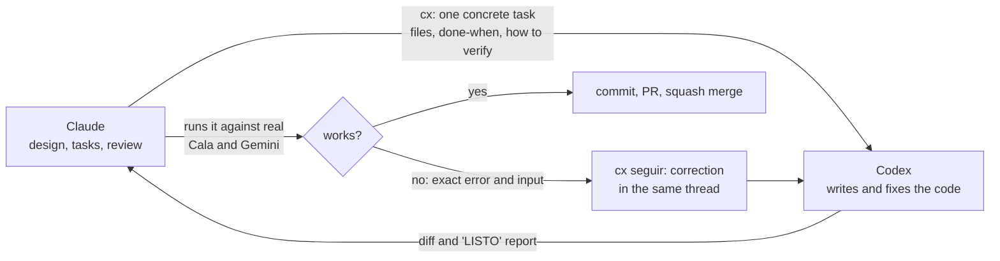

# Built with Codex

**Claude plans and reviews, Codex writes the code, Gemini is the AI inside the product.** By team rule, the application code in this repository is written by OpenAI Codex from concrete tasks, and checked against the real Cala and Gemini services before it was merged. This page is the evidence: how we worked, what Codex built, and how much we used it.

## The numbers

| | |
|---|---|
| Codex tasks logged on the orchestrator machine (`bau`) | **19**, all finished successfully, in 10 separate conversations |
| Of those, follow-up corrections after a real test (`seguir`) | **9** |
| Codex time on that machine | **53 min** (14 Nov, 02:20 to 16:16) |
| Tokens on that machine | **14.4 M input** (**95% from cache**), **184 k output**, 28 k reasoning |
| Gabriel's machine (`gabriel`) | **4 tasks, 12 min, 5.2 M input** (96% cached), **115 k output** |
| Fabricio's machine (`fabricio`) | **30 tasks, 107 min, 34.9 M input** (96% cached), **371 k output** |
| Adrian's machine (`adrian`) | **10 tasks, 17 min, 8.9 M input** (95% cached), **120 k output** |
| **Team total (four machines)** | **63 tasks, about 189 min of Codex time, 63.4 M input tokens, 790 k output tokens** |
| Code in `main` | about **7,500 lines** of Python and TypeScript at the time of the first count, and growing (app, backend, canonizer, catalog, graph, feed API) |
| Tests | **274** backend tests and **49** canonizer tests in `main` (counted with `pytest --collect-only` on 15 Nov) |

## 1. How we use Codex

- **Roles with their own model and effort** (`cx roles`): `backend` and `frontend` use `gpt-6-luna` at medium effort; `orquestador` runs at high effort; `ideas`, `seguridad` and `revisor` are read-only roles for brainstorming, security and review; trivial tasks use `gpt-5.6-luna` at low effort.
- **One task = one precise brief.** Each task names the files to read, the done-when criterion and how to verify it. Codex runs in a sandbox with workspace-write and never commits, pushes or switches branches: the human side owns Git.
- **Corrections stay in the same thread** (`cx seguir <thread> "..."`) so the context is reused. Threads that grow long get expensive, so new work gets a new thread. This helps explain why 95% of input tokens come from cache.
- **Four people, four machines, one flow.** Everyone delegates to Codex with the same `cx` tool and the same issue, branch and pull request rules (`CLAUDE.md`).
- **A task that hangs is cut and relaunched** instead of waiting.

## 2. What Codex built

| Component | What it is | Tasks |
|---|---|---|
| **Query canonizer** (`canonizador/`) | Turns any phrasing of a question into one canonical Cala query: intent extraction, entity resolution, fixed query templates, two cache layers. Takes consistency from 0 to 1 out of 9 up to **9 out of 9** | 6 |
| **Cala core** (`backend/cala_core/`) | Message router (query, claim, profile, chat), executor with fallbacks across Cala's tools, source normalization | 4 |
| **Gemini provider** | Gemini as an LLM provider for text, images and audio, with strict JSON schemas | 2 |
| **Chat backend** and **voice** | Sessions, text and audio messages, profile, recommendations; Gemini transcription that returns the literal transcript plus a clean intent in one call | Fabricio's machine |
| **Cala client optimizer** (#63) | Per-endpoint pacing, `Retry-After`, one request in flight per key; measured up to 1.89 calls/s with zero 429 | Fabricio's machine |
| **Expo app** (`app/`) | Chat with audio, profile, design system | Fabricio's machine |
| **Context ingestion** (#66) | PDF and voice notes into the profile with Gemini | In main |
| **n8n flows** (#47) | Daily journal and Cala query workflows. Built, then dropped with the journal; never merged (PR #61 closed) | Gabriel's machine |
| **Shared graph store** (#64) and **feed API** (#65) | Shared graph and feed API | In main |
| **Accounts, context and voice** (#112/#121) | Email authentication, fixed role, raw context and voice preview | In main |
| **Favorites PDF report** (#131/#137) | Cala-backed report and action plan | In main |
| **Abuse protection** (#134) | Shared limits and negative cache | In main |
| **Vercel SPA** (#133) | Static web export configuration | In main |
| First prototype: **pitch-deck verifier** | Built end to end in the first hours (backend, CLI, API and UI). We later dropped it from the product, but it is where we learned the pipeline and the rules Cala needs | 6 |

## 3. Why Codex worked well here

The pattern that paid off is **test against the real services, then hand Codex the exact failure**. Nine of the 19 tasks are corrections like these, taken from the log:

| What the real test showed | What Codex did |
|---|---|
| Gemini returned HTTP 400 `Unknown name "type"` | Normalized the schema converters to handle type lists and nested `properties` and `items` |
| The deck run failed with "Codex exceeded the 180 s timeout" | Made the timeout configurable (`CODEX_TIMEOUT`) |
| The retrieval step returned 422 from Cala | Switched round retrieval to filter locally |
| The judge marked "I was unable to find any evidence" as a contradiction | Taught it that absence of evidence is not contradiction |
| Filters failed to normalize with the real LLM | Made them deterministic |
| Open questions should go to the search tool, with sources | Extracted sources from `context[].origins[]` and named the block correctly |

Each correction was a short task with the failing input attached. The nine follow-ups took a median of 103 seconds of Codex time (from 34 s to 7.8 min).

## 4. Task log, `bau` machine (from `cx log`)

Task summaries are translated from the log. The first six rows are the pitch-deck verifier prototype, which is no longer in the repository.

| Date | Role | Model | Task (summary) | Result | Min |
|---|---|---|---|---|---|
| 14/11 02:20 | backend | gpt-6-luna | Implement the deck verifier backend according to docs/SPEC-verificador.md: Stack, Modules… | READY: Verifier backend, sample deck, CLI, and tests implemented; does not include `app.py… | 3.2 |
| 14/11 02:25 | backend | gpt-6-luna | (follow-up) I tested the real CLI with Cala + Codex: it works (59 s), but I fixed this in pipeline.py and the d… | READY: Adjusted extraction to exclude marketing, forced queries for public claims… | 1.5 |
| 14/11 02:25 | frontend | gpt-6-luna | Implement app.py (in demo/) and the deck verifier UI in demo/static/index.html according to docs/SPEC-verifica… | READY: Implemented the jobs API and responsive verifier UI. | 1.9 |
| 14/11 02:29 | backend | gpt-6-luna | (follow-up) The real run failed: 'Codex exceeded the 180-second timeout' (there are more claims now). Changes: 1… | READY: `CODEX_TIMEOUT` configures the Codex timeout (default 420 s); errors indicate whether f… | 1.6 |
| 14/11 02:31 | frontend | gpt-6-luna | (follow-up) The pipeline now exposes progress: verify_pdf accepts on_progress(stage, done, total) (read demo/verifier… | READY: Connected stage-by-stage progress and elapsed time. | 1.0 |
| 14/11 02:32 | backend | gpt-6-luna | In demo/verifier/pipeline.py, the judge prompt marks 'contradicted' when Cala says 'I was unable to find … | READY: The judge distinguishes absence of evidence from a contradiction and extracts internal metrics… | 0.8 |
| 14/11 03:13 | backend | gpt-6-luna | Implement the Cala query canonizer according to docs/internal/SPEC-canonizador.md (also read docs/internal/CALA-CAMPOS.md… | READY: Implemented the standalone package in `canonizador/`, with normalization, an LLM provider… | 3.2 |
| 14/11 03:27 | backend | gpt-6-luna | (follow-up) The real run failed in canonizador/canonizador/intent.py (CodexProvider). Two fixes: (1) the sch… | READY: CodexProvider now generates strict schemas, closes stdin, and uses a 120 s timeout with st… | 0.6 |
| 14/11 03:28 | backend | gpt-6-luna | (follow-up) Intent now works (all 3 variants resolve to Amenitiz db95edaa-058f-494d-a4f4-5f56bf81afd9), p… | READY: Round retrieval filters locally, sends only accepted keys to Cala, and requests pro… | 2.6 |
| 14/11 03:49 | backend | gpt-6-luna | Implement phase 2 of docs/internal/SPEC-canonizador.md in canonizador/ (read that section, docs/internal/CALA-SKILL.md, and the … | READY: Phase 2 implemented in `canonizador/`; the Amenitiz query revealed the discrepancy in… | 3.6 |
| 14/11 03:54 | backend | gpt-6-luna | (follow-up) I tested with the real LLM. Amenitiz: all 4 variants return the same string and answer (good). Fi… | READY: Filters normalized deterministically; both cases generate the same query and the … | 1.7 |
| 14/11 04:04 | backend | gpt-6-luna | Bug in canonizador/ (read canonizador/canonizador/api.py, plan.py, client.py). With the real LLM, the lists (co… | READY: Separated the main response from enrichment and adjusted the retrieval body to the co… | 2.2 |
| 14/11 13:48 | backend | gpt-6-luna | Issue #30: implement backend/cala_core/ according to docs/internal/PLAN-CALA-CENTRO.md (sections 1–5) and the block contract… | READY: Implemented `backend/cala_core/` and the local editable dependency on Cala Canonizer. Ad… | 5.8 |
| 14/11 14:00 | backend | gpt-6-luna | (follow-up) I tested cala_core with real Codex and Cala: it works (query, contradicted claim, mixed message). Co… | READY: Normalized sources, cleaned profile patches, canonicalized interests, and generated a title… | 2.8 |
| 14/11 15:59 | rapido | gpt-5.6-luna | Reply only: READY: ok | READY: ok | 0.7 |
| 14/11 15:59 | backend | gpt-6-luna | Issue #43: add Gemini as an LLM provider. Read backend/verifier/llm.py (providers with complete_json(sy… | READY: Gemini added as an LLM provider, with text, image, and audio support in the bac… | 5.2 |
| 14/11 16:05 | backend | gpt-6-luna | (follow-up) I tested with the real key: Gemini returns HTTP 400 'Unknown name "type" … Proto field is not repeatin… | READY: Both converters normalize type lists and traverse `properties`, `items`, `anyOf` … | 2.5 |
| 14/11 16:10 | backend | gpt-6-luna | Issue #49 (current branch). Read backend/cala_core/router.py and executor.py (already in main with the fallback fixes… | READY: Router, executor, and profile merging updated for Issue #49. | 4.6 |
| 14/11 16:16 | backend | gpt-6-luna | (follow-up) I tested with real Gemini and Cala. Open questions now go to knowledge_search (good). Two failures:… | READY: Search sources extracted from `context[].origins[]`, `cala_answer` title based … | 7.8 |

## 5. Other machines

- **`gabriel`:** 4 tasks, 12 min, 5,177,047 input tokens (96% cached), 115,061 output, model `gpt-6-luna`. They built the three n8n workflows (#47, later dropped and not merged) and the context module (#66).
- **`fabricio`:** 30 tasks, 107 min, 34.9 M input tokens (96% cached), 371 k output. Cala client optimizer and shared rate limit, Gemini audio, feed and detail API with the affinity score, shared graph store on Valkey, journal and chat integration, design system, router fixes, Valkey connection.
- **`adrian`:** 10 tasks, 17 min, 8.9 M input tokens (95% cached), 120 k output. Context adaptation; #112/#121 email authentication, fixed role, raw context and voice preview; #133 Vercel SPA configuration.

## 6. How to regenerate

Each machine keeps its log in `~/agentes/estado/codex.jsonl`; `cx log` summarizes it. Per machine, add a section with the totals (tasks, minutes, input, cached and output tokens) and the table, as in section 4. The totals at the top of this page are updated from those sections.
