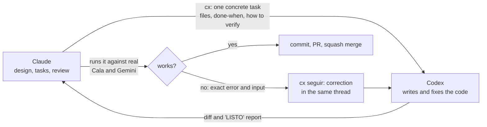

# Built with Codex

**Claude plans and reviews, Codex writes the code, Gemini is the AI inside the product.** By team rule, the application code in this repository is written by OpenAI Codex from concrete tasks, and checked against the real Cala and Gemini services before it was merged. This page is the evidence: how we worked, what Codex built, and how much we used it.

## The numbers

| | |
|---|---|
| Codex tasks logged on the orchestrator machine (`bau`) | **19**, all finished successfully, in 10 separate conversations |
| Of those, follow-up corrections after a real test (`seguir`) | **9** |
| Codex time on that machine | **53 min** (14 Nov, 02:20 to 16:16) |
| Tokens on that machine | **14.4 M input** (**95% from cache**), **184 k output**, 28 k reasoning |
| Gabriel's machine | **4 tasks, 12 min, 5.2 M input** (96% cached), **115 k output** |
| Code in `main` | about **7,500 lines** of Python and TypeScript (app 2,700, backend 2,800, canonizer 2,000) |
| Tests | **104** test functions; the suites run green (61 backend, 43 canonizer at the last check) |

Fabricio's and Adrian's logs are not in these totals yet (see section 5). The real figure is higher.

## 1. How we use Codex

- **Roles with their own model and effort** (`cx roles`): `backend` and `frontend` use `gpt-6-luna` at medium effort; `orquestador` runs at high effort; `ideas`, `seguridad` and `revisor` are read-only roles for brainstorming, security and review; trivial tasks use `gpt-5.6-luna` at low effort.
- **One task = one precise brief.** Each task names the files to read, the done-when criterion and how to verify it. Codex runs in a sandbox with workspace-write and never commits, pushes or switches branches: the human side owns Git.
- **Corrections stay in the same thread** (`cx seguir <thread> "..."`) so the context is reused. Threads that grow long get expensive, so new work gets a new thread. This helps explain why 95% of input tokens come from cache.
- **Four people, four machines, one flow.** Everyone delegates to Codex with the same `cx` tool and the same issue, branch and pull request rules (`CLAUDE.md`).
- **A task that hangs is cut and relaunched** instead of waiting.

## 2. What Codex built

| Component | What it is | Tasks |
|---|---|---|
| **Query canonizer** (`canonizador/`) | Turns any phrasing of a question into one canonical Cala query: intent extraction, entity resolution, fixed query templates, two cache layers. Takes consistency from 0 to 1 out of 9 up to **9 out of 9** | 6 |
| **Cala core** (`backend/cala_core/`) | Message router (query, claim, profile, chat), executor with fallbacks across Cala's tools, source normalization | 4 |
| **Gemini provider** | Gemini as an LLM provider for text, images and audio, with strict JSON schemas | 2 |
| **Chat backend** and **voice** | Sessions, text and audio messages, profile, recommendations; Gemini transcription that returns the literal transcript plus a clean intent in one call | Fabricio's machine |
| **Cala client optimizer** (#63) | Per-endpoint pacing, `Retry-After`, one request in flight per key; measured up to 1.89 calls/s with zero 429 | Fabricio's machine |
| **Expo app** (`app/`) | Chat with audio, profile, design system | Fabricio's machine |
| **Context ingestion** (#66, in review) | PDF and voice notes into the profile with Gemini | Gabriel's machine |
| **n8n flows** (#47, in review) | Daily journal and Cala query workflows, validated against the n8n schema | Gabriel's machine |
| **Shared graph store** (#64) and **feed API** (#65) | Work in progress on open branches | Fabricio's machine |
| First prototype: **pitch-deck verifier** | Built end to end in the first hours (backend, CLI, API and UI). We later dropped it from the product, but it is where we learned the pipeline and the rules Cala needs | 6 |

## 3. Why Codex worked well here

The pattern that paid off is **test against the real services, then hand Codex the exact failure**. Nine of the 19 tasks are corrections like these, taken from the log:

| What the real test showed | What Codex did |
|---|---|
| Gemini returned HTTP 400 `Unknown name "type"` | Normalized the schema converters to handle type lists and nested `properties` and `items` |
| The deck run failed with "Codex exceeded the 180 s timeout" | Made the timeout configurable (`CODEX_TIMEOUT`) |
| The retrieval step returned 422 from Cala | Switched round retrieval to filter locally |
| The judge marked "I was unable to find any evidence" as a contradiction | Taught it that absence of evidence is not contradiction |
| Filters failed to normalize with the real LLM | Made them deterministic |
| Open questions should go to the search tool, with sources | Extracted sources from `context[].origins[]` and named the block correctly |

Each correction was a short task with the failing input attached. The nine follow-ups took a median of 103 seconds of Codex time (from 34 s to 7.8 min).

## 4. Task log, `bau` machine (from `cx log`)

| Date | Role | Model | Task (summary) | Result | Min |
|---|---|---|---|---|---|
| 14/11 02:20 | backend | gpt-6-luna | Implementá la parte backend del verificador de decks según docs/SPEC-verificador.md: secciones Stack, Módulos… | LISTO: Backend del verificador, deck de ejemplo, CLI y tests implementados; no incluye `app.py… | 3.2 |
| 14/11 02:25 | backend | gpt-6-luna | (seguir) Probé la CLI real con Cala + Codex: funciona (59 s), pero corregí esto en pipeline.py y el deck de e… | LISTO: Ajusté la extracción para excluir marketing, forcé la consulta de afirmaciones públicas… | 1.5 |
| 14/11 02:25 | frontend | gpt-6-luna | Implementá app.py (en demo/) y la UI demo/static/index.html del verificador de decks según docs/SPEC-verifica… | LISTO: Implementé la API de jobs y la UI responsive del verificador. | 1.9 |
| 14/11 02:29 | backend | gpt-6-luna | (seguir) La corrida real falló: 'Codex excedió el timeout de 180 segundos' (ahora hay más claims). Cambios: 1… | LISTO: `CODEX_TIMEOUT` configura el timeout de Codex (default 420 s); los errores indican si f… | 1.6 |
| 14/11 02:31 | frontend | gpt-6-luna | (seguir) El pipeline ya expone progreso: verify_pdf acepta on_progress(stage, done, total) (leé demo/verifier… | LISTO: Conecté el progreso por etapas y el tiempo transcurrido. | 1.0 |
| 14/11 02:32 | backend | gpt-6-luna | En demo/verifier/pipeline.py, el prompt del juez marca 'contradicted' cuando Cala dice 'I was unable to find … | LISTO: el juez distingue ausencia de evidencia de una contradicción y extrae métricas internas… | 0.8 |
| 14/11 03:13 | backend | gpt-6-luna | Implementá el canonizador de consultas a Cala según docs/SPEC-canonizador.md (leé también docs/CALA-CAMPOS.md… | LISTO: Implementé el paquete independiente en `canonizador/`, con normalización, proveedor LLM… | 3.2 |
| 14/11 03:27 | backend | gpt-6-luna | (seguir) La corrida real falló en canonizador/canonizador/intent.py (CodexProvider). Dos arreglos: (1) el sch… | LISTO: CodexProvider ahora genera schemas estrictos, cierra stdin, usa timeout de 120 s con st… | 0.6 |
| 14/11 03:28 | backend | gpt-6-luna | (seguir) El intent ya funciona (las 3 variantes resuelven a Amenitiz db95edaa-058f-494d-a4f4-5f56bf81afd9), p… | LISTO: El retrieval de rondas filtra localmente, envía a Cala solo claves admitidas y pide pro… | 2.6 |
| 14/11 03:49 | backend | gpt-6-luna | Implementá la 'Fase 2' de docs/SPEC-canonizador.md en canonizador/ (leé esa sección, docs/CALA-SKILL.md y el … | LISTO: Fase 2 implementada en `canonizador/`; la consulta de Amenitiz marcó la discrepancia en… | 3.6 |
| 14/11 03:54 | backend | gpt-6-luna | (seguir) Probé con el LLM real. Amenitiz: las 4 variantes dan la misma cadena y la misma respuesta (bien). Fi… | LISTO: filtros normalizados de forma determinista; ambos casos generan la misma consulta y el … | 1.7 |
| 14/11 04:04 | backend | gpt-6-luna | Bug en canonizador/ (leé canonizador/canonizador/api.py, plan.py, client.py). Con el LLM real, las listas (co… | LISTO: separé la respuesta principal del enriquecimiento y ajusté el cuerpo de retrieval al co… | 2.2 |
| 14/11 13:48 | backend | gpt-6-luna | Issue #30: implementá backend/cala_core/ según docs/PLAN-CALA-CENTRO.md (secciones 1–5) y el contrato de bloq… | LISTO: Implementé `backend/cala_core/` y la dependencia editable local de Cala Canonizador. Aj… | 5.8 |
| 14/11 14:00 | backend | gpt-6-luna | (seguir) Probé cala_core con Codex y Cala reales: anda bien (consulta, claim contradicted, mensaje mixto). Co… | LISTO: Normalicé las fuentes, limpié los parches de perfil, canonizé intereses y generé título… | 2.8 |
| 14/11 15:59 | rapido | gpt-5.6-luna | Respondé solo: LISTO: ok | LISTO: ok | 0.7 |
| 14/11 15:59 | backend | gpt-6-luna | Issue #43: agregá Gemini como proveedor de LLM. Leé backend/verifier/llm.py (proveedores con complete_json(sy… | LISTO: Gemini agregado como proveedor de LLM, con soporte de texto, imágenes y audio en el bac… | 5.2 |
| 14/11 16:05 | backend | gpt-6-luna | (seguir) Probé con la clave real: Gemini devuelve HTTP 400 'Unknown name "type" … Proto field is not repeatin… | LISTO: Ambos conversores normalizan listas de tipos y recorren `properties`, `items`, `anyOf` … | 2.5 |
| 14/11 16:10 | backend | gpt-6-luna | Issue #49 (rama actual). Leé backend/cala_core/router.py y executor.py (ya en main con los arreglos de respal… | LISTO: Router, executor y fusión de perfiles actualizados para Issue #49. | 4.6 |
| 14/11 16:16 | backend | gpt-6-luna | (seguir) Probé con Gemini y Cala reales. Las preguntas abiertas ya van a knowledge_search (bien). Dos fallas:… | LISTO: fuentes de búsqueda extraídas de `context[].origins[]`, título de `cala_answer` basado … | 7.8 |

## 5. Other machines

- **`gabriel`:** 4 tasks, 12 min, 5,177,047 input tokens (96% cached), 115,061 output, model `gpt-6-luna`. They built the three n8n workflows (#47), validated with `n8n-mcp`, and the context module (#66).
- **`fabricio`:** see the table below.
- **`adrian`:** *pending.*

### `fabricio` machine (from `cx log`)

30 tasks in 21 conversations, 26 finished (`LISTO`), 4 ended blocked or without a result; 8 were follow-up corrections (`seguir`). Codex time: **107 min** (14/11 10:58 to 14/11 22:05, local time). Tokens: **34.9 M input** (**96% from cache**), **371 k output**, 80 k reasoning. Model `gpt-6-luna`.

Built here: the Cala client optimizer and rate-limit measurement (#63), audio with Gemini (#50), the affinity feed and entity detail API (#65), the graph store in Valkey (#64), the rate limit shared through Valkey (#85), plus the earlier journal, chat and router work.

| Date | Role | Model | Task (summary) | Result | Min |
|---|---|---|---|---|---|
| 14/11 10:58 | frontend | gpt-6-luna | Crea el proyecto app/ (Expo + TypeScript + Expo Router) en una carpeta nueva app/. Requisitos: (1) cliente tip… | LISTO: creada la app Expo con TypeScript, Expo Router, cliente tipado y pantalla de salud. | 2.2 |
| 14/11 11:06 | frontend | gpt-6-luna | Issue #8 en app/ (Expo Router + TypeScript, ya existe; cliente en app/src/api/index.ts). No toques backend/ ni… | LISTO: implementadas las pestañas Deck, Chat, Perfil y Estado; cliente API, verificación d… | 3.6 |
| 14/11 11:12 | frontend | gpt-6-luna | Issue #7 en app/ (Expo Router + TS; cliente en app/src/api/index.ts; ya hay pestañas y una pestaña Chat placeh… | LISTO: Implementé el chat de texto y audio, la sesión compartida y el modo mock. | 3.4 |
| 14/11 11:48 | backend | gpt-6-luna | Issue #3 en backend/ (FastAPI, uv). Lee docs/API.md (sección 'Chat con audio' y 'Perfil'), backend/app.py y ba… | LISTO: Implementé el chat con persistencia SQLite, perfil, rutas y pruebas. | 1.8 |
| 14/11 11:51 | backend | gpt-6-luna | Issue #4 en backend/ (FastAPI, uv). Lee backend/chat/ (engine.py, routes.py, store.py) y docs/API.md 'Chat con… | LISTO: transcripción configurable, audio multipart y pruebas implementados. | 2.6 |
| 14/11 12:06 | backend | gpt-6-luna | Issue #5 en backend/. Lee docs/API.md (Chat y 'Perfil y recomendaciones'), backend/chat/*.py, backend/verifier… | LISTO: recomendaciones en segundo plano, persistencia SQLite y avisos con cards y fuentes. | 2.4 |
| 14/11 12:09 | backend | gpt-6-luna | (seguir) Faltan cosas: (1) tests del flujo en backend/tests/test_recommend.py: un mensaje que actualiza el per… | LISTO: dependencia de Cala sobrescribible, errores inesperados guardados como `error` y `u… | 2.3 |
| 14/11 13:56 | frontend | gpt-6-luna | Issue #33 del repo (rama actual fabricio/33-bloques-chat). Lee docs/API.md (sección Bloques, tipos Source y Ca… | LISTO: Implementé los tipos, el renderizado de bloques en el chat, el estilo compartido de… | 2.1 |
| 14/11 13:59 | frontend | gpt-6-luna | (seguir) Nueva tarea, issue #34 (ya estás en la rama fabricio/34-journal, que parte de lo anterior ya commitea… | LISTO: Añadí el journal para Ecosistema y Para ti, con contenido simulado, regeneración y… | 2.0 |
| 14/11 14:09 | backend | gpt-6-luna | Issue #32 (rama actual fabricio/32-chat-cala-core). Lee docs/API.md (Bloques, Chat con audio, Perfil), docs/PL… | LISTO: chat conectado a `cala_core`, bloques persistidos y perfil ampliado con rol e inter… | 2.2 |
| 14/11 16:02 | frontend | gpt-6-luna | Adopta el sistema de diseño de app/src/theme.tsx y app/src/ui/ (ya aplicado en app/app/estado.tsx y app/app/pe… | LISTO: Adopté el tema en las tabs y pantallas, usé `SourceTable` y `VerdictBadge`, y quité… | 3.3 |
| 14/11 16:35 | backend | gpt-6-luna | Issue #56. Lee backend/cala_core/router.py, backend/cala_core/__init__.py (handle_message, _profile_patch, _me… | LISTO: fusioné los parches de perfil, reforcé el prompt y añadí caché del router por texto… | 5.4 |
| 14/11 16:35 | backend | gpt-6-luna | Issue #54. Lee canonizador/canonizador/cache.py, canonizador/README.md (sección Valkey), el script cache_sync… | LISTO: Valkey usa timeout configurable de conexión (8 s) y lectura (3 s), reutiliza un cli… | 8.7 |
| 14/11 21:20 | backend | gpt-6-luna | Issue #63: optimizador del cliente de Cala (léelo: gh issue view 63). Trabaja solo en canonizador/ (canonizado… | LISTO: Optimizador del cliente Cala implementado; no hice llamadas reales a la API. | 5.2 |
| 14/11 21:25 | backend | gpt-6-luna | Issue #50 (backend): audio con Gemini — transcripción literal + intención limpia en UNA llamada. Trabaja solo… | BLOQUEADO: codex no devolvió mensaje final. | 3.2 |
| 14/11 21:27 | backend | gpt-6-luna | Tarea (issue #65, parte 1 de 2): crear el paquete nuevo `backend/api/` con el puntaje de afinidad y el perfila… | LISTO: paquete de afinidad y perfilado implementado; la suite completa pasa. | 3.9 |
| 14/11 21:28 | backend | gpt-6-luna | Issue #50 (backend): audio con Gemini — transcripción literal + intención limpia en UNA llamada. Trabaja solo… | LISTO: Implementé la transcripción con Gemini en una llamada, limpieza de intención, respa… | 3.6 |
| 14/11 21:33 | backend | gpt-6-luna | (seguir) Dos correcciones chicas tras la prueba real (no hagas commit; no leas backend/.env; ignora lo de assu… | LISTO: Reforcé el prompt para quitar muletillas y arranques de discurso, y actualicé el mo… | 0.4 |
| 14/11 21:35 | backend | gpt-6-luna | Tarea (issue #65, parte 2 de 2): endpoints del feed y del detalle de Cala Match sobre un CATALOGO precalculado… | LISTO: Implementados el catálogo local con refresco por lotes, grafo en memoria, afinidad… | 5.4 |
| 14/11 21:35 | backend | gpt-6-luna | Tarea (issue #64, parte 1 de 2): crear el paquete `backend/graph/` con el modelo, el almacén del grafo compart… | LISTO: creado `backend/graph/` con modelo, almacén en memoria/Valkey, unión de duplicados… | 4.1 |
| 14/11 21:40 | backend | gpt-6-luna | (seguir) Segunda ronda sobre `backend/graph/store.py` (ya commiteado por mí; tú no hagas commit). La versión a… | LISTO: lecturas y escrituras de grafo agrupadas; el saneamiento de aliases ya no escanea t… | 16.9 |
| 14/11 21:42 | backend | gpt-6-luna | (seguir) Revision de la parte 2 (mismas reglas: sin commit, sin cambiar de rama, sin leer backend/.env, solo b… | LISTO: Corregidos la inyección de Cala, el enriquecimiento, la afinidad compartida entre f… | 8.7 |
| 14/11 21:52 | backend | gpt-6-luna | (seguir) Ultimos ajustes (mismas reglas: sin commit, sin cambiar de rama, sin leer backend/.env; solo backend/… | LISTO: Ajusté las rondas del detalle y ordené `why_match`; amplié los tests de contratos. | 1.0 |
| 14/11 21:55 | backend | gpt-6-luna | (seguir) Cuatro retoques de texto vistos en una prueba real (mismas reglas: sin commit, sin cambiar de rama, s… | LISTO: Ajusté las etiquetas de región, el formato de tickets, los facts como strings y el… | 2.3 |
| 14/11 21:58 | backend | gpt-6-luna | Tarea acotada sobre `backend/graph/store.py` y `backend/tests/test_graph_store.py` (issue #64). Lee esos dos a… | BLOQUEADO: Implementé `read_batch`, `rels_key`/`node_is_expanded`, actualicé la configurac… | 1.9 |
| 14/11 22:00 | backend | gpt-6-luna | (seguir) Ya hice commit de lo que dejaste. No estás bloqueado: nada externo impide terminar; continúa y comple… | BLOQUEADO: No completé los pasos A–C. En este turno solo volví a tomar los bloqueos; no ca… | 0.6 |
| 14/11 22:01 | backend | gpt-6-luna | Tarea corta (issue #65, PR #77): arreglar 4 hallazgos de revision en `backend/api/` con un test por cada uno.… | LISTO: Corregidos los hallazgos del perfil, tickets, carga del catálogo Valkey y vecinos d… | 2.8 |
| 14/11 22:02 | backend | gpt-6-luna | Refactor de rendimiento, acotado a `backend/graph/store.py` (+ tests en `backend/tests/test_graph_store.py`).… | BLOQUEADO: la implementación quedó incompleta y la suite de `test_graph_store.py` falla en… | 2.0 |
| 14/11 22:02 | backend | gpt-6-luna | Tarea (issue #85). Area: canonizador/canonizador/client.py, canonizador/tests/test_client_shared_limit.py (nue… | LISTO: límite compartido por endpoint con Valkey, fallback local ante errores y apagado me… | 1.8 |
| 14/11 22:05 | backend | gpt-6-luna | Tarea: en canonizador/scripts/medir_limite.py añade la opcion --sin-cache-local: apaga SOLO la cache de respue… | LISTO: añadí `--sin-cache-local`, que desactiva la caché de respuestas y conserva el remot… | 1.1 |

## 6. How to regenerate

Each machine keeps its log in `~/agentes/estado/codex.jsonl`; `cx log` summarizes it. Per machine, add a section with the totals (tasks, minutes, input, cached and output tokens) and the table, as in section 4. The totals at the top of this page are updated from those sections.
