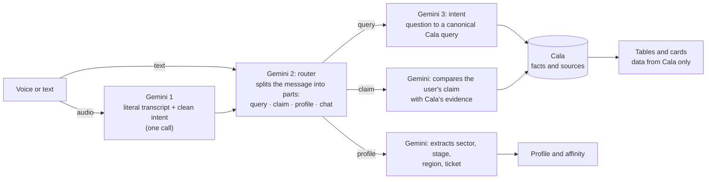

# How Cala Match uses Google Gemini

**Short version:** Gemini is the AI inside the product, at every point where a human says something messy and the system needs something exact. It listens, understands, classifies and normalizes. It **never introduces a fact**: every number, name and source on screen comes from Cala. That split is what makes the product trustworthy, and Gemini's speed and multimodality are what make it feel conversational.

Numbers are measured on 14 November 2026 with the team's real key unless noted. Status tags: **In main**, **In review** (open pull request), **Planned**.

## 1. Where Gemini sits

| Step | What Gemini does | Where | Status |
|---|---|---|---|
| **Audio** | Hears the audio and returns the **literal transcript and the clean intent in a single call**, replacing a separate speech model plus a cleanup model | `backend/chat/transcribe.py` | In main |
| **Router** | Splits one message into parts (a question, a claim about a company, a profile statement, small talk) so a mixed message is handled correctly | `backend/cala_core/router.py` | In main |
| **Intent** | Reduces any phrasing of a question to a structured intent that the canonizer turns into one canonical Cala query | `canonizador/canonizador/intent.py` | In main |
| **Claim judge** | Compares what the user said ("Mews raised 50 million") with the evidence Cala returned: confirmed, contradicted, partially confirmed or no data | `backend/cala_core/claims.py` | In main |
| **Row focus** | Given a table Cala returned, picks which rows answer the question. It returns **row indices only**; the answer is built from Cala's own cells | `backend/chat/focus.py` | In main |
| **Follow-up** | Rewrites "and their CEO?" into a self-contained question using only what was already said in the conversation, adding no new facts | `backend/chat/followup.py` | In main |
| **Recommendations** | Turns a Cala research answer into up to five cards, **using only facts stated in the answer**; each card must cite numbered sources, and cards with invalid citations are dropped | `backend/chat/recommend.py` | In main |
| **Context from PDFs and voice notes** | Reads pitch-deck pages (text and images) and notes, extracts sector, stage, region and ticket | `backend/context/` (#66) | In main |
| **Catalog tags** | Tags the sector and stage of ~3,000 Slush companies from the descriptions Cala already has, in parallel, without spending Cala's rate limit | `backend/catalog/` (#72) | In main |
| **Favorites report action plan** | Proposes 3 to 5 steps per favorite using only Cala facts and drops steps that introduce new figures | `backend/api/favorites_report.py` | In main |

## 2. Why Gemini, specifically

1. **One multimodal call replaces a pipeline.** Audio goes in, a literal transcript and a clean intent come out. That removes a hop, and it removes a failure point. Example from our real run: the user says *"Quién lideró la serie A, no, perdón, la serie B de Amenitiz"*. The transcript keeps exactly what was said; the clean text is *"Quién lideró la serie B de Amenitiz?"*, which then returns Cala's Series B table.
2. **Speed that keeps a conversation alive.** The fast model (`gemini-3.5-flash-lite`) answers in about **1 s per call** (3 of 3 on the router test), and audio takes **1.2 to 2.3 s** on the synthetic clips Fabricio tested. A message may pass through two or three Gemini calls, so each one has to be cheap.
3. **Strict structure, zero free text.** Every call asks for JSON against a response schema, at temperature 0 (`responseMimeType: application/json` plus `responseSchema`). The code never parses prose, and the same input gives the same structure. We had to fix our schema converter for Gemini's stricter dialect (it rejected `type` lists), which Codex did the same day.
4. **Images and audio in the same API.** Pitch-deck pages go in as images and voice notes as audio, with one provider class for text, images and audio.
5. **It lets us keep Cala as the only source of facts.** The router, the intent and the judge work because Gemini is good at language; the claims it checks are checked against Cala's evidence, not against its own memory.

## 3. The rule that makes it safe: Gemini interprets, Cala asserts

| Gemini does | Gemini never does |
|---|---|
| Understand what the user means | Introduce a figure, a name or a date that Cala did not return |
| Classify, split and normalize text | Answer a question about a company from its own knowledge |
| Judge a claim against evidence Cala returned | Invent a source |
| Tag text for ranking (sector, stage) | Show those tags as facts: they are labeled "AI-tagged from Cala's description" |

If Cala has no data, the app says so and shows what was searched. It does not fill the gap with a model guess.

## 4. What we measured end to end

Spoken to the real backend (synthetic voice, so names are a hard case) with Gemini and Cala live:

| Spoken input | Result | Total time |
|---|---|---|
| "Quién lideró la serie A, no, perdón, la serie B de Amenitiz" | Correct transcript, self-correction cleaned, Cala Series B table with sources | **17 s** (mostly Cala) |
| "Which Nordic funds invested in fintech startups this year?" | Perfect transcript in English | 56 s (Cala's slow search path) |
| "Somos Stayflow, software para hoteles en Barcelona. Estamos levantando una ronda semilla de dos millones de euros" | Profile updated, **but** the voice mangled two names and the clean text dropped them | **6.5 s** |

We report the third result as a defect, not a success: when a name is unclear the model should keep it, not delete it. It is filed (#83) with the failing input, together with moving all user-facing text to English. A human-voice test is still pending.

**Resilience:** if the Gemini audio call fails, the backend falls back to local Whisper instead of failing the message. Provider, model and transcription engine are visible in `/api/health`.

## 5. Configuration

| Variable | Default | Use |
|---|---|---|
| `GEMINI_API_KEY` (or `GOOGLE_API_KEY`) | none | In `backend/.env` only, never in the repo |
| `GEMINI_FAST_MODEL` | `gemini-3.5-flash-lite` | The chat path: router, audio, focus, follow-up, claims and recommendations |
| `GEMINI_MODEL` | `gemini-flash-latest` | The strong tier (default of `make_llm`) |
| `GEMINI_TRANSCRIBE_MODEL` | the fast model | Override for audio |
| `LLM_PROVIDER` | `gemini` when a key exists | Other providers (`nvidia`, `codex`, `claude`) stay as fallbacks |

## 6. What we would do next
- Run the audio test with real human voices, including Argentine Spanish, and measure how often a proper noun is kept.
- Move the catalog tagging (#72) to Gemini batch calls and compare tags with the sector Cala already stores.
- Stream the router's first reply so the app shows "looking it up in Cala" while the slow endpoints work.
